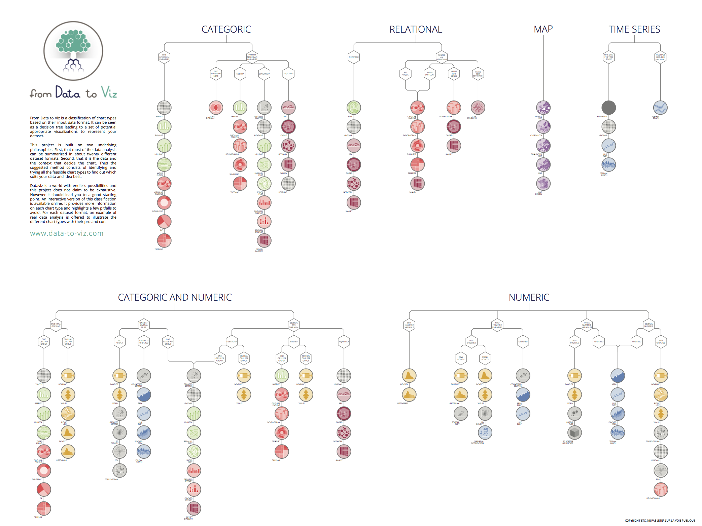

<br>
<hr>

[data-to-viz.com](https://www.data-to-viz.com)

<br>

Overview
-----
From [Data to Viz.com](https://www.data-to-viz.com) is a website aiming to help in your chart decision. It classifies most of the chart types based on their input data format. It comes in the form of a decision tree leading to a set of potentially appropriate visualizations to represent your dataset.

<br>

Development
-----
The site is a [Next.js](https://nextjs.org) app (App Router, Tailwind CSS, shadcn/ui) exported as static HTML and deployed to GitHub Pages.

```bash
npm install
npm run dev     # http://localhost:3000
npm run build   # static site in out/
```

Pushing to `master` builds and deploys the site (`.github/workflows/deploy.yml`).

Where things are:

- `app/graph/<slug>/page.tsx`, `app/story/<slug>/page.tsx`, `app/caveat/<slug>/page.tsx`: one page per chart, data story and caveat. The text is written directly in JSX. Each page is exported to the same URL as before, e.g. `/graph/barplot.html`.
- `app/page.tsx` and `components/home/`: the home page (decision trees, stories, chart portfolio). Its data lives in `components/home/data/`.
- `components/`: layouts, navbar, footer and the article building blocks (`Section`, `Code`, `Widget`, `RelatedCard`…).
- `public/figures/`: chart images (webp). `public/widgets/`: interactive htmlwidgets, embedded with iframes.
- `img/` and `Example_dataset/` stay at the repository root because other sites link to their GitHub URLs; `img/` is copied into `public/img` at build time.
- `legacy/`: the previous R Markdown / Bootstrap site, kept for reference. `scripts/migrate/` holds the one-shot scripts that converted it.

Note: the dev server does not always pick up edits to `app/globals.css`. If styles look stale, stop it, delete `.next/` and run `npm run dev` again.

<br>

Sections
-----
- *[Decision Tree](https://www.data-to-viz.com/#explore)* - leads you from your data format to a set of potential graphics.
- *[Data story](https://www.data-to-viz.com/#story)* - for each data format, an example of data analysis based on real data is performed.
- *[All graphics](https://www.data-to-viz.com/#portfolio)* - an overview of all graphics presented in the website. A set of explanation and advices is provided for each.
- *[Caveats](https://www.data-to-viz.com/caveats.html)* - a gallery of common caveats in dataviz, with explanation and workarounds.

<br>

Poster
-----
The decision tree offered in the website are also available in a [high quality poster](https://www.data-to-viz.com/poster.html). Buy it to support the project!



<br>

Feedbacks
-----
Any feedback is highly encouraged. You can fill an [issue](https://github.com/holtzy/data_to_viz/issues) on Github, drop us a message on [Twitter](https://twitter.com/R_Graph_Gallery), or send an email pasting yan.holtz.data with gmail.com.

<br>

Acknowledgment
-----
See a complete list of acknowledgment [here](https://www.data-to-viz.com/about.html#acknowledgmentanchor)
